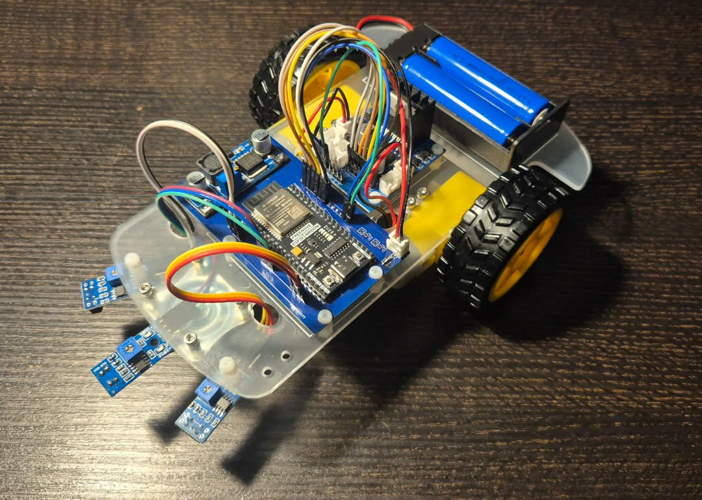
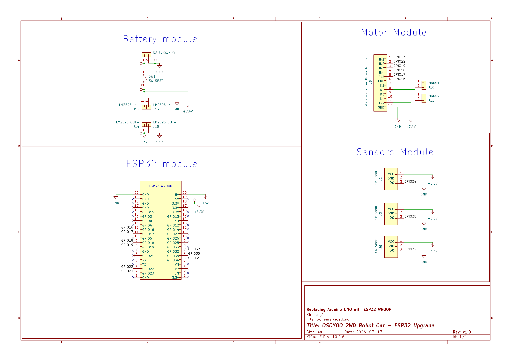
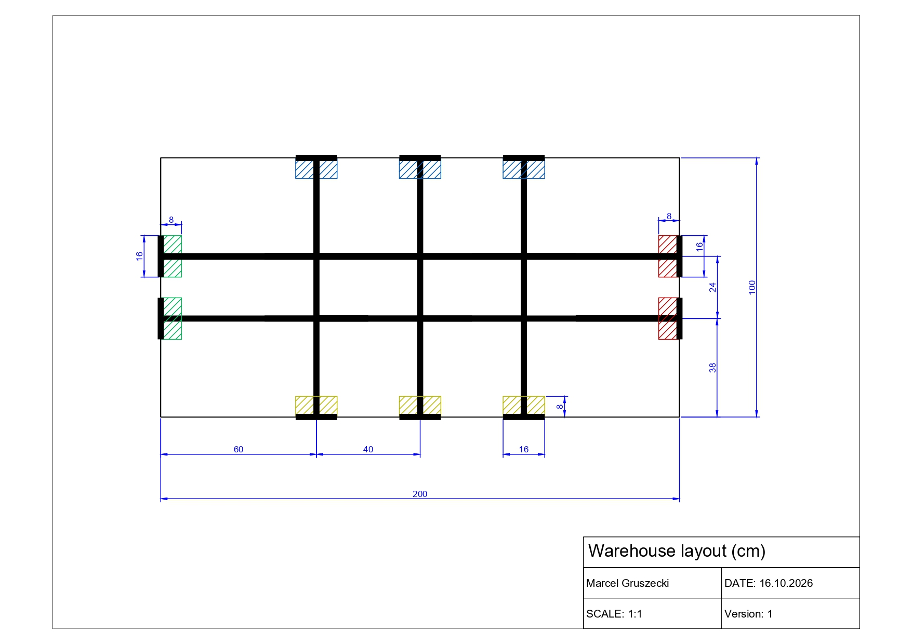

# Autonomous AGV Fleet — ESP32 Line Followers in a Scale Warehouse

A fleet of two autonomous guided vehicles (AGVs) that serve a self-built scale
warehouse. Each vehicle runs on a custom ESP32 PCB and follows a taped line network.
A Python control server plans collision-free routes for both robots, and a warehouse
layer on top of it turns deliveries and customer orders into transport jobs.

The project covers the full development cycle: electrical schematic and PCB, hardware
assembly, embedded firmware, multi-robot path planning, and warehouse logistics.

The mechanical platform comes from the *OSOYOO 2WD Robot Car Starter Kit for Arduino*,
which was used as a chassis and drivetrain base only. The stock Arduino Uno and its
motor shield were removed and replaced with a self-designed ESP32-WROOM carrier board,
adding Wi-Fi connectivity and a 32-bit MCU in place of the original 8-bit controller.



## Demo

<!-- GitHub only plays videos uploaded through its editor (drag & drop the file
     into README.md on github.com and it inserts a user-attachments URL here). -->
<video src="video.mp4" controls width="720"></video>

If the player does not load, open [video.mp4](video.mp4) directly.

## Hardware

**Custom PCB (KiCad, manufactured by PCBWay)** — a single-board carrier designed from
scratch, integrating:

- Power section based on LM2596 step-down converters (7.4 V Li-ion pack → 5 V / 3.3 V rails)
- Separate power distribution path for the motor driver
- Connectors for a three-channel TCRT5000 optical line-sensor array
- ESP32-WROOM main circuit with an optimised keepout zone under the RF antenna

**Drivetrain and sensing** — 2× DC gear motors driven through a Model-X dual H-bridge
(PWM speed control on ENA/ENB), 3× TCRT5000 reflective sensors for line detection.



*Electrical schematic: battery and power conversion, ESP32-WROOM module, motor
driver interface, and the line-sensor array (KiCad).*

The board was assembled by hand (T12 soldering station), including component selection,
mechanical integration, and debugging of short-circuit and polarity faults on the first
revision. Both robots use the same PCB revision.

## Warehouse layout



*Scale 1:10, board 200 × 100 cm. CAD source: `Warehouse_model/`.*

The track is a graph of 16 nodes. Coordinates are in cm, (0, 0) is the top-left
corner, x grows to the right and y downwards.

| Node | Role | Position |
|------|------|----------|
| `IN1`, `IN2` | Inbound stations — goods arrive here (green) | left edge, y = 38 / 62 |
| `OUT1`, `OUT2` | Outbound stations — goods leave here (red) | right edge, y = 38 / 62 |
| `C1`, `C2`, `C3` | Chargers / robot home positions (blue) | top edge, x = 60 / 100 / 140 |
| `R1`, `R2`, `R3` | Racks, one item type each: `A`→`R1`, `B`→`R2`, `C`→`R3` (yellow) | bottom edge, x = 60 / 100 / 140 |
| `T60` … `T140`, `B60` … `B140` | Intersections of the two horizontal lines with the three vertical lines | y = 38 / 62 |

Stations, chargers and racks are *fields* — dead ends of a line with a stop bar.
A robot drives onto a field, stops on the bar, and turns 180° to leave. The two ends
of each short vertical connector (e.g. `T60`–`B60`) are treated as one place, so only
one robot can be on them at a time.

## Software architecture

```
 warehouse.py  ──HTTP /goal, /status──▶  serwer.py  ◀──HTTP /command, /done──  ESP32 robot 1
 (stock, orders,                         (CBS path planning,                    ESP32 robot 3
  task dispatch)                          command scheduling)
```

- `OSOYOO/` — ESP32 firmware, C++ on the Arduino framework (PlatformIO). PD line
  following on three sensors, turns at intersections, 180° turns on fields.
- `Server/serwer.py` — control server (Flask). Plans paths for all robots together
  and hands each robot one command at a time.
- `Server/mapf.py` — multi-agent path finding: Conflict-Based Search
  (Sharon et al., 2015) with space-time A*, turned into an Action Dependency Graph
  (Hönig et al., 2019) so the robots stay collision-free even though they do not
  move in lock-step.
- `Server/warehouse.py` — warehouse layer: keeps the rack stock, queues deliveries
  and orders, and decides which robot goes where.
- `Scheme/` — KiCad schematic, PCB layout, and Gerber files.
- `Warehouse_model/` — CAD drawing of the warehouse board.

### Robot ↔ server protocol

The robot polls `GET /command?robot=<id>` every 100 ms and receives plain text
`"<id> <COMMAND>"` (`"0 STOP"` = nothing to do). After executing it, the robot confirms
with `GET /done?robot=<id>&id=<id>`. Until the confirmation arrives, the server keeps
returning the same command; the robot recognises the id it has already executed, so a
lost confirmation never makes it drive twice.

| Command | Meaning |
|---------|---------|
| `FORWARD [n]` | Follow the line and stop on the stop bar of a field |
| `FORWARD_AFTER_LINE [n]` | Follow the line and stop with the axle on an intersection; `n` = number of intersections to pass (straight drives are merged) |
| `TURN_LEFT`, `TURN_RIGHT` | Rotate 90° on an intersection |
| `RETURN_LEFT`, `RETURN_RIGHT` | Rotate 180° on a field, away from the neighbouring field |
| `STOP` | Stand still |

### Server HTTP API

| Endpoint | Used by | Description |
|----------|---------|-------------|
| `GET /command?robot=<id>` | robot | Current command, see above |
| `GET /done?robot=<id>&id=<cmd id>` | robot | Confirms a command, updates the robot position |
| `GET /goal?robot=<id>&to=<node>` | warehouse | Sets a goal node and replans all robots; `400 {"error": ...}` if the node is taken |
| `GET /status` | warehouse | State of all robots, see [JSON formats](#json-formats) |

## Getting started

### Requirements

- PlatformIO (CLI or the VS Code extension)
- Python 3.8+ with `pip install -r Server/requirements.txt` (Flask)
- The PC running the server and both robots on the same Wi-Fi network

### 1. Configure and flash each robot

```bash
cd OSOYOO/include
cp config.example.hpp config.hpp
```

Edit `config.hpp`:

```cpp
const char* const WIFI_SSID  = "your-wifi";
const char* const WIFI_PASS  = "your-password";
const char* const SERVER_URL = "http://192.168.1.10:8080";   // IP of the PC running serwer.py

#define ROBOT_ID "1"   // "1" for the first robot, "3" for the second one
```

The robot ids must match the server: robot `1` starts on charger `C1`, robot `3` on
`C3` (configured in `robots` in `Server/serwer.py`). `config.hpp` holds your Wi-Fi
password and is ignored by git.

Flash the robot (repeat for the second one with a different `ROBOT_ID`):

```bash
cd OSOYOO
pio run -t upload          # upload_port in platformio.ini: /dev/ttyUSB0
pio device monitor         # optional: serial log, 115200 baud
```

### 2. Place the robots

Put robot `1` on `C1` and robot `3` on `C3`, facing the edge of the board (away from
the track). On the first start the server assumes exactly this position. After that
it remembers the positions in `server_state.json`; delete that file whenever you put
the robots back on their chargers by hand.

### 3. Start the warehouse and the server

In two terminals, inside `Server/`:

```bash
python warehouse.py            # warehouse layer, interactive terminal
python serwer.py               # control server on port 8080
```

`warehouse.py` keeps retrying until the server answers, so the start order does not
matter. Once the robots connect to Wi-Fi they start polling for commands.

`warehouse.py` options:

```bash
python warehouse.py --simulate [--seed 42]                       # random deliveries and orders
python warehouse.py --replay logs/session_YYYYMMDD_HHMMSS.json   # repeat a recorded session
python warehouse.py --replay <file> --speed 2                    # ... twice as fast
```

`serwer.py --random` sends the robots to random free fields without the warehouse
(useful for testing the path planning alone).

### 4. Give the warehouse work

```
>>> in A IN2       # item A arrived at IN2 -> a robot stores it on rack R1
>>> out A OUT1     # item A requested at OUT1 -> a robot takes it from R1 to OUT1
>>> status         # racks, waiting goods, waiting orders, robot tasks
>>> quit
```

Task priority: orders first (from the rack if it has stock, otherwise cross-docking
straight from an inbound station if the item is waiting there), then storing waiting
goods on racks that are not full (capacity 5). A robot with nothing to do returns to
its charger.

## JSON formats

All files are written atomically (to a `.tmp` file, then renamed), so a crash never
leaves a half-written file. Thanks to them both programs can be restarted at any time
and continue where they stopped.

### `Server/server_state.json` — written by `serwer.py`

Saved after every change of a robot's state.

```json
{
  "next_id": 1761400000,
  "robots": {
    "1": {
      "position": "C1",
      "heading": "S",
      "goal": "R1",
      "actions": [
        {"cmd": "FORWARD", "to": "R1", "heading": "S", "seq": 4, "deps": [["3", 2]]}
      ],
      "current": {
        "id": 1761399999,
        "cmd": "FORWARD_AFTER_LINE 2",
        "actions": [
          {"cmd": "FORWARD", "to": "T60", "heading": "S", "seq": 2, "deps": []},
          {"cmd": "FORWARD", "to": "B60", "heading": "S", "seq": 3, "deps": []}
        ]
      },
      "done_seq": 1
    },
    "3": { "...": "same structure" }
  }
}
```

| Field | Meaning |
|-------|---------|
| `next_id` | Id of the next command. Starts at the Unix time, so ids keep growing across server restarts and a robot never mistakes a new command for an old one |
| `position`, `heading` | Node the robot is on after its last confirmed command and the direction it faces (`N`, `E`, `S`, `W`; `N` = towards the chargers) |
| `goal` | Node the robot should reach, `null` = stay |
| `actions` | Planned actions not sent to the robot yet |
| `current` | Command sent to the robot and waiting for `/done`, `null` if none. `cmd` is the text the robot receives, `actions` are the planned actions it covers |
| `done_seq` | Sequence number of the robot's last finished action |
| action `cmd` / `to` / `heading` | Planned move (`FORWARD`, `TURN_LEFT`, `TURN_RIGHT`, `RETURN`), the node and heading after it |
| action `seq` | Sequence number of the action within its robot |
| action `deps` | `[robot, seq]` pairs: the action may start only after that robot has finished action `seq` (i.e. has left the node this robot is about to enter) |

### `GET /status` — returned by `serwer.py`, read by `warehouse.py`

```json
{
  "1": {"position": "C1", "heading": "N", "home": "C1", "goal": "R1", "busy": true},
  "3": {"position": "C3", "heading": "N", "home": "C3", "goal": null, "busy": false}
}
```

`home` is the robot's charger. `busy` is `true` while the robot has a command in
progress, planned actions, or has not reached its goal yet.

### `Server/warehouse_state.json` — written by `warehouse.py`

Saved after every event and every pickup or drop.

```json
{
  "racks": {"A": 2, "B": 0, "C": 5},
  "inbound": [{"item": "B", "station": "IN1"}],
  "orders": [{"item": "C", "station": "OUT2"}],
  "tasks": {
    "1": {"kind": "store", "item": "A", "pickup": "IN2", "drop": "R1", "stage": "drop"},
    "3": null
  }
}
```

| Field | Meaning |
|-------|---------|
| `racks` | Pieces on each rack, by item type (`A` → `R1`, `B` → `R2`, `C` → `R3`), max 5 |
| `inbound` | Goods waiting at an inbound station, oldest first |
| `orders` | Requests waiting at an outbound station, oldest first |
| `tasks` | Task of each robot, `null` = idle |
| task `kind` | `store` (IN → rack), `deliver` (rack → OUT) or `crossdock` (IN → OUT directly) |
| task `pickup`, `drop` | Where the robot loads and unloads the item |
| task `stage` | `pickup` = driving to the pickup node, `drop` = carrying the item to the drop node |

### `Server/logs/session_<date>_<time>.json` — written by `warehouse.py`

Every run (except `--replay`) records its events, so the same workload can be repeated
later with `--replay`.

```json
{
  "initial_state": { "...": "warehouse_state.json at the start of the session" },
  "events": [
    {"t": 3.2, "type": "delivery", "item": "A", "station": "IN2"},
    {"t": 11.8, "type": "order", "item": "A", "station": "OUT1"}
  ]
}
```

`t` is the time in seconds since the start of the session, `type` is `delivery`
(goods arrived at an inbound station) or `order` (goods requested at an outbound
station).

## Tech stack

KiCad · PCBWay · ESP32-WROOM · C++ / Arduino · PlatformIO · Python · Flask ·
Conflict-Based Search · Action Dependency Graph · HTTP
